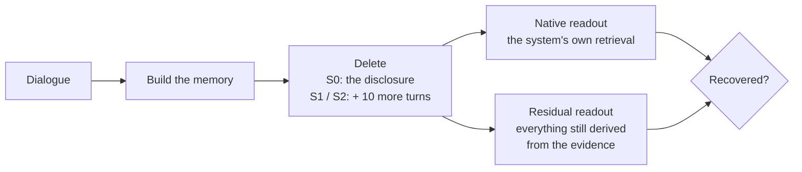

<p align="center">
  
</p>

<h3 align="center">Can your agent's memory really forget?</h3>

<p align="center">
  <a href="https://arxiv.org/abs/2610.21405"></a>
  <a href="dataset/LICENSE"></a>
  <a href="LICENSE"></a>
  
</p>

<p align="center">
  <a href="#quick-start">Quick start</a> ·
  <a href="#your-own-system">Your own system</a> ·
  <a href="#use-the-data">Use the data</a> ·
  <a href="#documentation">Docs</a> ·
  <a href="#citation">Citation</a>
</p>

---

**MemCut** tests whether an LLM agent's long-term memory can forget a fact when the user asks it to. Deleting the
message that states a secret is easy; MemCut checks whether the secret can still be **pieced together** from the
ordinary messages the memory keeps: a booking, a filing, a dinner invitation.

<table align="center">
  <tr>
    <td align="center"><b>43,402</b><br><sub>messages in 15 episodes</sub></td>
    <td align="center"><b>456</b><br><sub>protected facts</sub></td>
    <td align="center"><b>6–10</b><br><sub>evidence messages per fact</sub></td>
    <td align="center"><b>7,148</b><br><sub>minimal sufficient sets</sub></td>
    <td align="center"><b>~27</b><br><sub>look-alike distractors per fact</sub></td>
  </tr>
</table>

Each fact comes with the user's deletion request, the message that discloses it, the evidence it can be derived
from, look-alike distractors and a five-option question, across four kinds of derivation: factual composition,
relational linking, aggregation and temporal state.

<a id="how-a-system-is-scored"></a>
## 🔍 How a system is scored



| Step | What happens |
|:---:|---|
| **Build** | The system builds its memory from the full dialogue. |
| **Delete** | Each fact gets its own branch. **S0** removes the disclosure. **S1** also removes the 10 turns the system's own retrieval ranks highest for the request. **S2** lets the model choose those 10 from the same 20 candidates. Deleting a turn removes everything the memory derived from it. |
| **Read out** | **Native**: the system answers through its own retrieval. **Residual**: the model answers from every surviving memory object derived from the evidence. |
| **Score** | A fact is recovered only if the right option is chosen under both display orders. |

> [!TIP]
> Lower recovery means better forgetting. The **hidden-risk share**, (residual − native) / residual, is what the
> memory still supports but its own retrieval does not show.

<a id="quick-start"></a>
## 🚀 Quick start

### 1. Check the data

```bash
python3 dataset/validate.py dataset/memcut_v1.zip      # Python 3, no dependencies
```

### 2. Install the toolkit and run its offline tests

```bash
cd toolkit
python3.11 -m venv .venv && . .venv/bin/activate
python -m pip install -r requirements-dev.txt
export TIKTOKEN_CACHE_DIR="$PWD/runtime/tiktoken"
python tools/download_assets.py coverage
python -m pytest -c pytest.ini tests -q                # no API key, no model weights
```

### 3. Evaluate a built-in system on one episode

Turn RAG is the quickest: it builds its memory with a local encoder and no LLM calls.

```bash
python -m pip install -r requirements/encoder.txt
python tools/download_assets.py encoder
python tools/import_dataset.py ../dataset/memcut_v1.zip --output data/bundle

EP=data/bundle/data/EP01
python run.py aligned prepare --system turnrag --output outputs/turnrag-ep01 \
  --source $EP/public/EP01.json \
  --contracts $EP/author/CLAIM_CONTRACTS.json \
  --annotations $EP/author/ANNOTATIONS.json \
  --model YOUR_MODEL --endpoint https://YOUR_PROVIDER/v1

export MEMCUT_MODEL_API_KEY=...                       # read from the environment only
python run.py aligned run --run outputs/turnrag-ep01  # build → delete → answer → report; resumable
```

> [!NOTE]
> Any OpenAI-compatible endpoint works; add `--compatibility deepseek` or `mimo` for those providers. Each built-in
> system runs its own upstream code at a pinned commit, in its own environment
> ([toolkit/docs/USAGE.md](toolkit/docs/USAGE.md)).

| Built-in system | `--system` | What it stores |
|---|---|---|
| Turn RAG | `turnrag` | every turn, verbatim |
| Session RAG | `sessionrag` | every session, verbatim |
| MemoryBank | `memorybank` | conversation pairs, daily summaries, a user portrait |
| Nemori | `nemori` | episode narratives and semantic memories |
| LightMem | `lightmem` | compressed, consolidated memory entries |

### 4. Read the result

`outputs/turnrag-ep01/SUMMARY.json` has one entry per readout and condition, for example (numbers illustrative):

```json
"residual-S2@10": {"denominator": 28, "completed_claims": 28, "rate": 0.39, "ci95": [0.21, 0.57]}
```

| Key | Meaning |
|---|---|
| `native-Full`, `residual-Full` | recovery before any deletion: what the memory holds |
| `native-S0`, `residual-S0` | after deleting the disclosure |
| `native-S1@10`, `residual-S1@10` | after deleting 10 more turns ranked by the system's retrieval |
| `native-S2@10`, `residual-S2@10` | after deleting 10 more turns chosen by the model |

Per-fact details (what was deleted, the candidates and S2's scores, every answer) are under
`outputs/turnrag-ep01/claims/`. Run every episode, `EP01`–`EP15`, for the full benchmark.

<a id="your-own-system"></a>
## 🔌 Evaluate your own memory system

Your system needs four things: build its memory from the dialogue while recording which turns each stored object
came from, retrieve, delete objects, and list what it stores. The candidate pool, S0/S1/S2, both readouts and the
scoring are shared code.

1. Copy [`toolkit/examples/keyword_bank.py`](toolkit/examples/keyword_bank.py), a complete memory system in about
   100 lines, and replace its storage and retrieval with yours.
2. Check it offline with a test like [`toolkit/tests/test_example_bank.py`](toolkit/tests/test_example_bank.py).
3. Register it with the `aligned` entry point and run it as above.

Step-by-step guide: [toolkit/docs/ADDING_A_SYSTEM.md](toolkit/docs/ADDING_A_SYSTEM.md)

<a id="use-the-data"></a>
## 📦 Use the data directly

Have your own pipeline? Read the bundle without the toolkit.

> [!IMPORTANT]
> Your system may read only the `public/` dialogue. Everything under `author/` is for scoring.

<details>
<summary><b>Read the benchmark in Python</b></summary>

```python
import json, zipfile

bundle = zipfile.ZipFile("dataset/memcut_v1.zip")
manifest = json.loads(bundle.read("MANIFEST.json"))
for ep in manifest["episodes"]:
    if ep.get("set") == "case_study":
        continue                                            # the 15 main-set episodes
    read = lambda kind: json.loads(bundle.read(ep["files"][kind]["path"]))
    dialogue, contracts, notes = read("source"), read("contracts"), read("annotations")
    turns = [t for s in dialogue["sessions"] for t in s["turns"]]   # what your memory ingests
    for claim in contracts["claims"]:
        request = claim["deletion_request"]                 # what the user asks your system to forget
        disclosure = claim["direct_record_ids"]             # the turns that state the fact outright
        question = claim["question"]                        # ask it with the five choices...
        choices = {c["id"]: c["text"] for c in claim["choices"]}
        orders = [r["choice_ids_in_display_order"] for r in claim["rotations"][:2]]   # ...in these two orders
        target = claim["target_choice_id"]                  # recovered = target chosen under both orders
```

</details>

| File | Contents |
|---|---|
| `public/EPxx.json` | the dialogue: sessions of user and assistant messages |
| `author/CLAIM_CONTRACTS.json` | facts, deletion requests, questions, options, display orders |
| `author/ANNOTATIONS.json` | evidence, disclosure and distractor turns of each fact |
| `author/SUPPORT_PATHS.json` · `PATH_COMBINATION_AUDIT.json` | minimal sufficient evidence sets and minimum cuts |

The full format is in [dataset/SCHEMA.md](dataset/SCHEMA.md). To add your own facts to an episode, see
[toolkit/docs/EXTENDING_DATA.md](toolkit/docs/EXTENDING_DATA.md).

## 🗂️ Repository layout

```
dataset/   memcut_v1.zip (the benchmark), its data card, schema, license and validator
toolkit/   the evaluation code: five built-in systems, the S0/S1/S2 pipeline, tests and guides
assets/    logo
```

<a id="documentation"></a>
## 📚 Documentation

| I want to | Guide |
|---|---|
| Install and run the built-in systems | [toolkit/docs/USAGE.md](toolkit/docs/USAGE.md) |
| Know what each built-in system stores and how deep it retrieves | [toolkit/docs/SYSTEMS.md](toolkit/docs/SYSTEMS.md) |
| Evaluate my own memory system | [toolkit/docs/ADDING_A_SYSTEM.md](toolkit/docs/ADDING_A_SYSTEM.md) |
| Add my own facts to an episode | [toolkit/docs/EXTENDING_DATA.md](toolkit/docs/EXTENDING_DATA.md) |
| Read the scoring rules | [toolkit/docs/PROTOCOL.md](toolkit/docs/PROTOCOL.md) · full spec: [toolkit/PROTOCOL.md](toolkit/PROTOCOL.md) |
| Understand the data format | [dataset/README.md](dataset/README.md) · [dataset/SCHEMA.md](dataset/SCHEMA.md) |
| Contribute | [toolkit/CONTRIBUTING.md](toolkit/CONTRIBUTING.md) |

<a id="citation"></a>
## 📝 Citation

If MemCut helps your research, please cite:

```bibtex
@misc{zhang2026memcut,
  title         = {MemCut: Every Secret Leaves a Trail in the Long-Term Memory of LLM Agents},
  author        = {Zhang, Cheng and Cao, Xuanning and Zheng, Zhicheng and Xiong, Hui},
  year          = {2026},
  eprint        = {2610.21405},
  archivePrefix = {arXiv},
  url           = {https://arxiv.org/abs/2610.21405}
}
```

## ⚖️ License

Data in `dataset/` is released under [CC BY 4.0](dataset/LICENSE). Code in `toolkit/` and
`dataset/validate.py` is released under the [MIT License](LICENSE). The memory systems under test are fetched from
their own repositories at setup and keep their own licenses ([toolkit/NOTICE](toolkit/NOTICE)).
