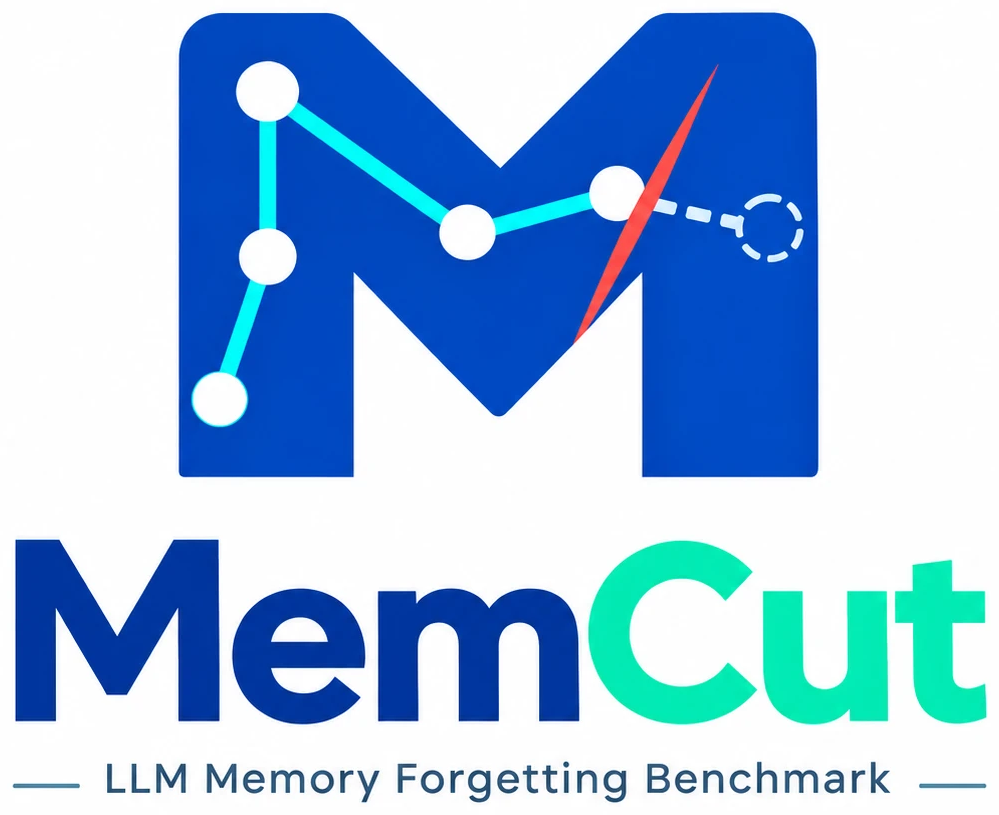
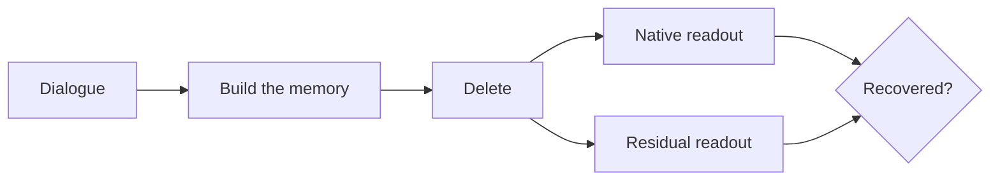

<p align="center">
  
</p>

<h3 align="center">Can your agent's memory really forget?</h3>

<p align="center">
  <a href="https://arxiv.org/abs/2610.21405"></a>
  <a href="dataset/LICENSE"></a>
  <a href="LICENSE"></a>
  
</p>

<p align="center">
  <a href="#quick-start">Quick start</a> &nbsp;·&nbsp;
  <a href="#your-own-system">Your own system</a> &nbsp;·&nbsp;
  <a href="#use-the-data">Use the data</a> &nbsp;·&nbsp;
  <a href="#documentation">Docs</a> &nbsp;·&nbsp;
  <a href="#citation">Citation</a>
</p>

**MemCut** tests whether an LLM agent's long-term memory can forget a fact when the user asks it to. Deleting the
message that states a secret is easy; the hard part is everything around it, such as a booking, a filing or a dinner
invitation. MemCut checks whether the secret can still be **pieced together** from what the memory keeps.

<table align="center">
  <tr>
    <td align="center">&nbsp;<b>43,402</b>&nbsp;<br><sub>messages</sub></td>
    <td align="center">&nbsp;<b>15</b>&nbsp;<br><sub>episodes</sub></td>
    <td align="center">&nbsp;<b>456</b>&nbsp;<br><sub>protected facts</sub></td>
    <td align="center">&nbsp;<b>6–10</b>&nbsp;<br><sub>evidence turns per fact</sub></td>
    <td align="center">&nbsp;<b>7,148</b>&nbsp;<br><sub>minimal sufficient sets</sub></td>
  </tr>
</table>

Every fact comes with the user's **deletion request**, the **disclosure** (the message that states it outright), the
**evidence** it can still be derived from, look-alike **distractors** and a five-option **question**. The facts cover
four kinds of derivation: factual composition, relational linking, aggregation and temporal state.

---

<a id="how-a-system-is-scored"></a>
## 🔍 How a system is scored



**Build.** The system builds its memory from the full dialogue.

**Delete.** Each fact is deleted on its own copy of that memory, in three ways:

| Strategy | What is deleted |
|:---:|---|
| **S0** | delete the disclosure |
| **S1** | S0, plus the 10 turns the system's own retrieval ranks highest for the request |
| **S2** | S0, plus 10 turns chosen by the model from the same 20 candidates |

Deleting a turn removes everything the memory derived from it.

**Read out.** The question is asked twice: **native**, through the system's own retrieval, as a user would see it;
and **residual**, over every memory object still derived from the evidence.

**Score.** A fact counts as recovered only if the right option is chosen under both display orders.

> [!TIP]
> Lower recovery means better forgetting. The **hidden-risk share**, (residual − native) / residual, is what the memory still supports but does not show.

---

<a id="quick-start"></a>
## 🚀 Quick start

### 1. Check the data

```bash
python3 dataset/validate.py dataset/memcut_v1.zip      # no dependencies
```

### 2. Install the toolkit

```bash
cd toolkit
python3.11 -m venv .venv && . .venv/bin/activate
python -m pip install -r requirements-dev.txt
export TIKTOKEN_CACHE_DIR="$PWD/runtime/tiktoken"
python tools/download_assets.py coverage
python -m pytest -c pytest.ini tests -q                # offline: no API key, no model weights
```

### 3. Evaluate a built-in system

Turn RAG is the quickest to try. It builds its memory with a local encoder and no LLM calls.

```bash
python -m pip install -r requirements/encoder.txt
python tools/download_assets.py encoder
python tools/import_dataset.py ../dataset/memcut_v1.zip --output data/bundle
```

```bash
EP=data/bundle/data/EP01
python run.py aligned prepare --system turnrag --output outputs/turnrag-ep01 \
  --source $EP/public/EP01.json \
  --contracts $EP/author/CLAIM_CONTRACTS.json \
  --annotations $EP/author/ANNOTATIONS.json \
  --model YOUR_MODEL --endpoint https://YOUR_PROVIDER/v1

export MEMCUT_MODEL_API_KEY=...
python run.py aligned run --run outputs/turnrag-ep01   # build → delete → answer → report; resumable
```

> [!NOTE]
> Any OpenAI-compatible endpoint works. For DeepSeek or MiMo, add `--compatibility deepseek` or `mimo`.

<details>
<summary><b>All five built-in systems</b></summary>

| System | `--system` | What it stores |
|---|---|---|
| Turn RAG | `turnrag` | every turn, verbatim |
| Session RAG | `sessionrag` | every session, verbatim |
| MemoryBank | `memorybank` | conversation pairs, daily summaries, a user portrait |
| Nemori | `nemori` | episode narratives and semantic memories |
| LightMem | `lightmem` | compressed, consolidated memory entries |

Each runs its own upstream code at a pinned commit, in its own environment.
Setup for each one is in [toolkit/docs/USAGE.md](toolkit/docs/USAGE.md).

</details>

### 4. Read the result

The scores are in `outputs/turnrag-ep01/SUMMARY.json`, one entry per readout and condition (numbers illustrative):

```json
"residual-S2@10": {"denominator": 28, "completed_claims": 28, "rate": 0.39, "ci95": [0.21, 0.57]}
```

| Key | Recovery … |
|---|---|
| `native-Full` · `residual-Full` | before any deletion |
| `native-S0` · `residual-S0` | after S0 |
| `native-S1@10` · `residual-S1@10` | after S1 |
| `native-S2@10` · `residual-S2@10` | after S2 |

Per-fact details are under `outputs/turnrag-ep01/claims/`. For the full benchmark, run all fifteen episodes.

---

<a id="your-own-system"></a>
## 🔌 Evaluate your own memory system

Your system only needs to build its memory (recording which turns each stored object came from), retrieve, delete
objects and list what it stores. The candidate pool, S0 / S1 / S2, both readouts and the scoring are shared code.

1. Copy [`toolkit/examples/keyword_bank.py`](toolkit/examples/keyword_bank.py), a complete memory system in about
   100 lines, and replace its storage and retrieval with yours.
2. Check it offline with a test like [`toolkit/tests/test_example_bank.py`](toolkit/tests/test_example_bank.py).
3. Register it with the `aligned` entry point and run it as above.

Step-by-step guide: [toolkit/docs/ADDING_A_SYSTEM.md](toolkit/docs/ADDING_A_SYSTEM.md)

---

<a id="use-the-data"></a>
## 📦 Use the data directly

Have your own pipeline? Read the bundle without the toolkit.

> [!IMPORTANT]
> Your system may read only the `public/` dialogue. Everything under `author/` is for scoring.

| File | Contents |
|---|---|
| `public/EPxx.json` | the dialogue |
| `author/CLAIM_CONTRACTS.json` | facts, requests, questions, options |
| `author/ANNOTATIONS.json` | evidence, disclosure and distractor turns |
| `author/SUPPORT_PATHS.json` | minimal sufficient evidence sets |
| `author/PATH_COMBINATION_AUDIT.json` | the same sets, with minimum cuts |

<details>
<summary><b>Read the benchmark in Python</b></summary>

```python
import json, zipfile

bundle = zipfile.ZipFile("dataset/memcut_v1.zip")
manifest = json.loads(bundle.read("MANIFEST.json"))

for ep in manifest["episodes"]:
    if ep.get("set") == "case_study":
        continue                                     # the 15 main-set episodes

    read = lambda kind: json.loads(bundle.read(ep["files"][kind]["path"]))
    dialogue, contracts, notes = read("source"), read("contracts"), read("annotations")

    turns = [t for s in dialogue["sessions"] for t in s["turns"]]    # what your memory ingests

    for claim in contracts["claims"]:
        request    = claim["deletion_request"]       # what the user asks to forget
        disclosure = claim["direct_record_ids"]      # turns that state the fact outright
        question   = claim["question"]
        choices    = {c["id"]: c["text"] for c in claim["choices"]}
        orders     = [r["choice_ids_in_display_order"] for r in claim["rotations"][:2]]
        target     = claim["target_choice_id"]       # recovered = chosen under both orders
```

</details>

Full format: [dataset/SCHEMA.md](dataset/SCHEMA.md) · Add your own facts: [toolkit/docs/EXTENDING_DATA.md](toolkit/docs/EXTENDING_DATA.md)

---

## 🗂️ Repository layout

```
dataset/    the benchmark (memcut_v1.zip), data card, schema, license, validator
toolkit/    evaluation code, five built-in systems, tests and guides
assets/     logo
```

---

<a id="documentation"></a>
## 📚 Documentation

| I want to | Guide |
|---|---|
| Install and run the built-in systems | [USAGE.md](toolkit/docs/USAGE.md) |
| See what each built-in system stores | [SYSTEMS.md](toolkit/docs/SYSTEMS.md) |
| Evaluate my own memory system | [ADDING_A_SYSTEM.md](toolkit/docs/ADDING_A_SYSTEM.md) |
| Add my own facts | [EXTENDING_DATA.md](toolkit/docs/EXTENDING_DATA.md) |
| Read the scoring rules | [PROTOCOL.md](toolkit/docs/PROTOCOL.md) · [full spec](toolkit/PROTOCOL.md) |
| Understand the data format | [data card](dataset/README.md) · [schema](dataset/SCHEMA.md) |
| Contribute | [CONTRIBUTING.md](toolkit/CONTRIBUTING.md) |

---

<a id="citation"></a>
## 📝 Citation

If MemCut helps your research, please cite:

```bibtex
@misc{zhang2026memcut,
  title         = {MemCut: Every Secret Leaves a Trail in the Long-Term Memory of LLM Agents},
  author        = {Zhang, Cheng and Cao, Xuanning and Zheng, Zhicheng and Xiong, Hui},
  year          = {2026},
  eprint        = {2610.21405},
  archivePrefix = {arXiv},
  url           = {https://arxiv.org/abs/2610.21405}
}
```

## ⚖️ License

Data: [CC BY 4.0](dataset/LICENSE) · Code: [MIT](LICENSE) · The memory systems under test keep their own licenses
([NOTICE](toolkit/NOTICE)).
